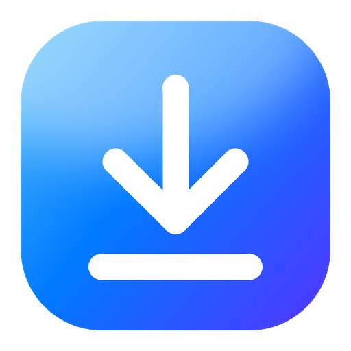

<p align="center">
  
</p>

<h1 align="center">Max Downloader</h1>

<p align="center">
  Baixe vídeos ou só o áudio de YouTube, Instagram, TikTok, X, Vimeo, SoundCloud e mais de 1.800 sites —<br>
  com uma interface moderna e minimalista inspirada no macOS.
</p>

<p align="center">
  <a href="https://github.com/emersonsg01/Max-Downloader/releases">Download</a> ·
  <a href="docs/GUIA.md">Guia de uso</a> ·
  <a href="docs/DESENVOLVIMENTO.md">Desenvolvimento</a>
</p>

---

## Recursos

**Vídeo**
- Resolução até 8K (só aparecem as que o vídeo realmente tem, com tamanho estimado)
- Quadros por segundo (60, 30…), **HDR** quando disponível
- Formato: MP4, MKV, WEBM ou MOV · Codec: Automático, H.264, VP9 ou AV1
- Qualidade do áudio do vídeo (máxima, equilibrada, econômica)

**Somente áudio**
- MP3, M4A, AAC, OPUS, OGG, FLAC, WAV ou Original (sem conversão)
- Qualidade de 96 a 320 kbps
- O app baixa em forma de vídeo, extrai o áudio com o FFmpeg e guarda só o áudio — com novas tentativas automáticas se algo falhar

**Extras**
- Capa incorporada, metadados e capítulos, legendas
- Pular patrocínios do YouTube (SponsorBlock)
- Cortar só um trecho com uma linha do tempo arrastável
- Playlists inteiras
- Conteúdo com restrição de idade, de membros ou privado (com o seu login), bloqueio regional e proxy

**Interface**
- Fila de downloads com progresso, velocidade, tempo restante, cancelar e tentar de novo
- "Dynamic Island" com o progresso e aviso de conclusão
- Brilho nas bordas enquanto analisa e fundo ambiente gerado pela capa do vídeo
- Tema claro, escuro ou automático e 8 cores de destaque
- Detecta links copiados e lembra suas últimas escolhas

Os arquivos ficam na pasta escolhida em **Ajustes**, separados em `Vídeos/` e `Áudios/`.

## Instalação

1. Baixe `MaxDownloader-Setup-x.y.z.exe` em [Releases](https://github.com/emersonsg01/Max-Downloader/releases).
2. Execute e siga o assistente (não precisa de administrador).
3. Abra o app e, em **Ajustes › Componentes**, clique em **Instalar** para baixar o FFmpeg.

Requisitos: Windows 10 ou 11 (64 bits) com o Microsoft Edge WebView2 (já vem no Windows 11).
Para o YouTube, recomenda-se ter o [Node.js](https://nodejs.org) ou o [Deno](https://deno.com) instalado.

## Rodando pelo código-fonte

```bash
pip install -r requirements.txt
python main.py
```

Para gerar o executável e o instalador, veja [docs/DESENVOLVIMENTO.md](docs/DESENVOLVIMENTO.md).

## Aviso

Baixe apenas conteúdo que você tem direito de usar e respeite os termos de cada site.
Conteúdo protegido por DRM (Netflix, Disney+, Spotify etc.) não é suportado.

## Créditos

Criado por **Emerson Gonçalves**

[](https://github.com/emersonsg01)
[](https://www.linkedin.com/in/emerson-gon%C3%A7alves-a9ba6582/)

Construído com [yt-dlp](https://github.com/yt-dlp/yt-dlp), [pywebview](https://pywebview.flowrl.com) e [FFmpeg](https://ffmpeg.org).
